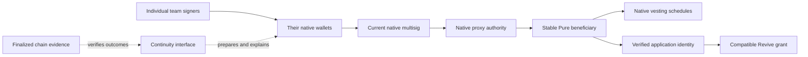
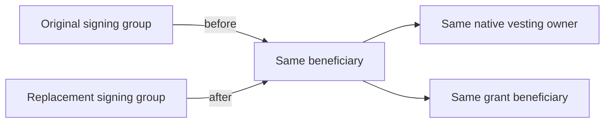

# Conceptual architecture

The interface coordinates a workflow. It does not become a custodian or a new authority over the beneficiary.

The human authorizes an outer transaction. The native multisig represents the group's threshold. Native proxy dispatch supplies the stable beneficiary origin. Revive uses the beneficiary's corresponding application identity. The grant still applies its own rules.

## What changes

The controlling multisig is replaced as a whole. The design does not keep a fixed outer multisig and silently replace the controllers of its individual seats, because previously recorded approvals would have different continuity implications.

## Trust boundaries

- Wallets retain each signer's private key and ask that signer to authorize a transaction.
- The chain enforces native account authority and grant contract rules.
- The interface prepares operations and interprets evidence. It must not invent authority from an imported file or a friendly label.
- A provider supplies chain observations. An unavailable or inconsistent provider is a reason to withhold a completion claim, not to assume success.
- Local workflow history helps a team resume, but it is not the authoritative account state.

There is no required language-model decision-maker in the transaction path. Human authorization and deterministic verification are the appropriate boundaries for this application.
